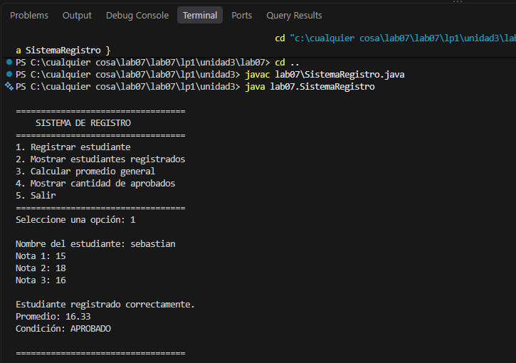

# Laboratorio 07 – Introducción al Lenguaje de Programación Java

## Estructura del proyecto

```text
lab07/
├── README.md
└──  SistemaRegistro.java  (Trabajo de laboratorio)
```

**Integrantes:**
| Integrante | Participacion |
:---:|:---|
| Sebastian Coaguila Suarez | 100% |
| Cristhian Chunga Pacheco | 100% |
| Robert Vilca Mendoza | 100% |

## Requisitos

- JDK 11 o superior (`java -version` y `javac -version` para verificar)..

## Compilación y ejecución

```bash
cd lab07
javac -encoding UTF-8 *.java
java SistemaRegistro
```

## Sistema de registro de estudiantes

Aplicación de consola con menú interactivo (se repite hasta elegir **5. Salir**):

1. **Registrar estudiante**: nombre y tres notas; calcula el promedio y la condición.
2. **Mostrar estudiantes registrados**: tabla con notas, promedio y condición.
3. **Calcular promedio general** de todos los registrados.
4. **Mostrar cantidad de aprobados** (promedio ≥ 11).
5. **Salir**.

Características: arreglos paralelos para almacenar los datos, máximo de 20 estudiantes,
validación de notas entre 0 y 20, validación de entradas no numéricas y métodos separados
por operación.

Ejemplo de ejecución:

```text
Seleccione una opción: 1

Nombre del estudiante: Ana
Nota 1: 15
Nota 2: 17
Nota 3: 16

Estudiante registrado correctamente.
Promedio: 16.00
Condición: APROBADO
```

## Capturas de pantalla



## Preguntas de comprensión

**Pregunta 1. ¿Cuál es la diferencia entre JDK, JRE y JVM?**

- **JVM (Java Virtual Machine):** máquina virtual que ejecuta el *bytecode* (`.class`). Es la que hace que Java sea independiente de la plataforma: traduce el bytecode al código de la máquina donde corre.
- **JRE (Java Runtime Environment):** entorno para *ejecutar* programas Java. Incluye la JVM más las bibliotecas estándar de clases.
- **JDK (Java Development Kit):** kit para *desarrollar*. Incluye el JRE más herramientas como el compilador `javac`, el depurador y `jar`.

En resumen: JDK ⊃ JRE ⊃ JVM. Para programar se necesita el JDK; para solo ejecutar, basta el JRE.

**Pregunta 2. ¿Diferencia entre `int` y `double`?**

`int` almacena números enteros de 32 bits (aprox. −2 147 483 648 a 2 147 483 647) sin parte decimal. `double` almacena números de punto flotante de 64 bits con parte decimal y mayor rango, aunque con precisión limitada. Al dividir dos `int` el resultado es entero (`7 / 2 = 3`), mientras que con `double` se conservan los decimales (`7.0 / 2 = 3.5`).

```java
int edad = 20;
double promedio = 16.5;
```

**Pregunta 3. Diferencias entre `for`, `while` y `do-while`**

- **`for`:** agrupa inicialización, condición y actualización en una línea. Se usa cuando se conoce de antemano el número de repeticiones (recorrer un arreglo, tablas de multiplicar).
- **`while`:** evalúa la condición *antes* de cada iteración, por lo que puede no ejecutarse nunca. Se usa cuando no se sabe cuántas veces se repetirá (leer datos hasta que se ingrese un valor válido).
- **`do-while`:** evalúa la condición *después*, así que el cuerpo se ejecuta al menos una vez. Es ideal para menús que se muestran siempre al menos una vez, como en el sistema de registro.

**Pregunta 4. Ventajas de usar métodos en lugar de todo en `main()`**

- **Reutilización:** se escribe la lógica una vez y se invoca las veces necesarias.
- **Legibilidad y organización:** cada método tiene una responsabilidad clara y `main` queda corto.
- **Mantenimiento:** un cambio o corrección se hace en un solo lugar.
- **Pruebas y depuración:** es más fácil probar piezas pequeñas por separado.
- **Trabajo en equipo y escalabilidad:** facilita dividir el trabajo y es la base para la programación orientada a objetos.
